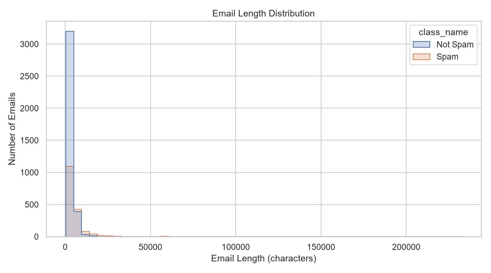
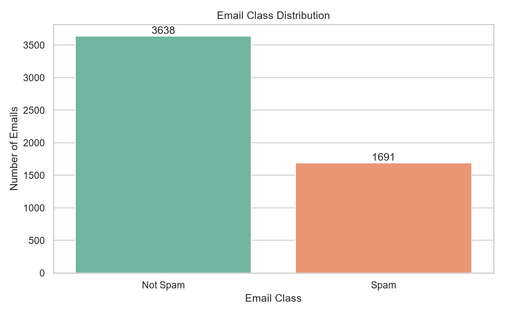
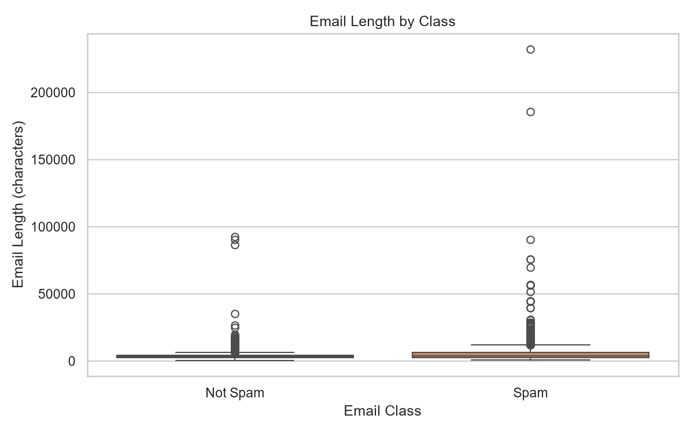

# SpamShield ML

SpamShield ML is a lightweight spam email detection app built with Python, Streamlit, scikit-learn, and TF-IDF text features. It analyzes incoming email text and predicts whether the message is likely spam or legitimate.

## Live Demo

Open the deployed app here:

https://spamshield-ml-m4cmb6mfuzvnsiohwcmrml.streamlit.app/

## Demo Screenshots







## Overview

This project combines:
- TF-IDF word features
- TF-IDF character features
- Linear Support Vector Machine classifier
- A tuned decision threshold for better practical performance
- A clean Streamlit interface for quick email analysis

The app is designed for demonstration, product-style presentation, and reliable local use.

## Features

- Detect spam emails from pasted email content
- Use a trained ML model for classification
- Strong handling for false positives in legitimate email content
- Clean, modern user interface
- Sidebar metrics for model performance
- Local execution with no backend required

## Project Structure

```text
SpamShield-ML/
├── app.py                     # Streamlit app entry point
├── requirements.txt          # Python dependencies
├── README.md                 # Project documentation
├── .gitignore                # Git ignore rules
├── data/
│   ├── archive/
│   └── processed/
├── models/
│   ├── spam_classifier_candidate.joblib
│   ├── spam_classifier_final.joblib
│   └── spam_classifier_threshold_tuned.joblib
├── reports/
│   ├── final_test_metrics.csv
│   ├── model_comparison.csv
│   ├── tfidf_comparison.csv
│   └── threshold_comparison.csv
├── src/
│   ├── check_data_leakage.py
│   ├── clean_dataset.py
│   ├── compare_tfidf.py
│   ├── eda.py
│   ├── evaluate_final.py
│   ├── inspect_dataset.py
│   ├── inspect_labels.py
│   ├── prepare_data.py
│   ├── spam_logic.py
│   ├── train_models.py
│   ├── tune_threshold.py
│   └── validate_dataset.py
└── tests/
    └── test_spam_guard.py
```

## Installation

Clone the repository and install the dependencies:

```bash
git clone https://github.com/nageenashaik123/spamshield-ml.git
cd spamshield-ml
python -m venv .venv
.venv\Scripts\activate
pip install -r requirements.txt
```

On macOS/Linux:

```bash
python -m venv .venv
source .venv/bin/activate
pip install -r requirements.txt
```

## Run the app

```bash
streamlit run app.py
```

Then open the local URL shown in the terminal, typically:

```text
http://localhost:8501
```

## Model notes

The project trains a classifier using combined TF-IDF features. The final model is stored under the `models/` directory as serialized joblib artifacts. The tuned threshold logic helps reduce false positives while keeping detection effective.

## Testing

Run the regression tests:

```bash
pytest
```

## License

This project is for educational and demonstration purposes.

## Author

Shaik Nageena

## Contact

For questions or improvements, feel free to extend the project or open an issue in the repository.
